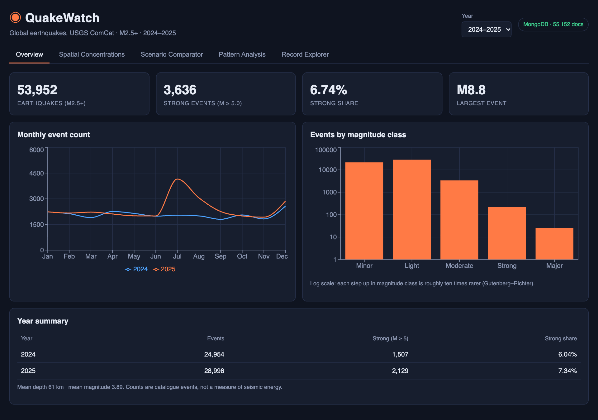
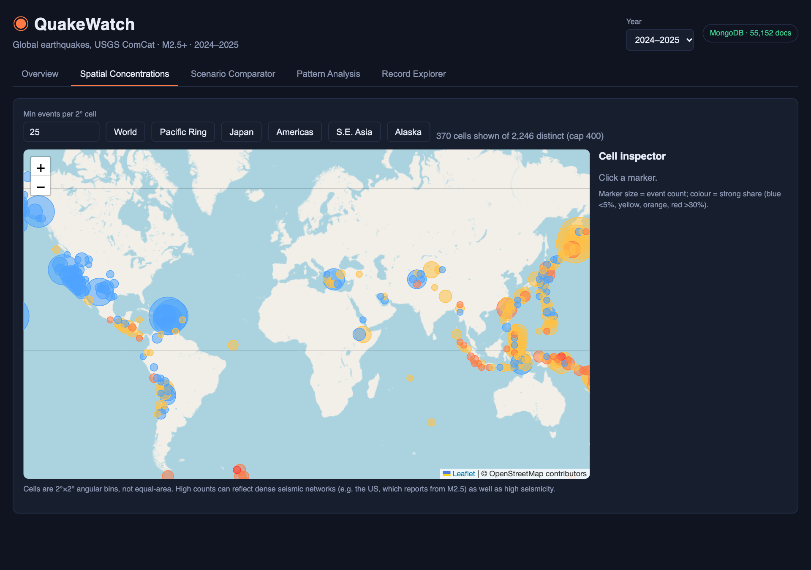

# QuakeWatch – Spatial and Temporal Analysis of Global Earthquakes

Big Data Management (Semester VII) course project, ABV-IIITM Gwalior.
Analysis of **53,952 tectonic earthquakes (M2.5+) from 2024–2025** from the USGS ComCat catalogue,
using MongoDB, Python, Flask, React and a BI dashboard.

**Team:** Anurag (2023IMG-008) · Kushagra (2023IMG-030) · Kshitij (2023IMG-029) · Vibhor (2023IMG-054)

```
USGS FDSN API ─▶ download_data.py ─▶ prepare.py ─▶ import_data.py ─▶ MongoDB (3 collections, 6 indexes)
                                                │                          │
                                                ▼                          ▼
                                         export_bi.py ─▶ CSV star schema   Flask API ─▶ React + Leaflet web app
                                                │
                                                ▼
                                    dashboard/index.html  /  Power BI
```

## Key numbers
| | |
|---|---|
| Earthquakes (type = earthquake, M2.5+) | 53,952 (2024: 24,954 · 2025: 28,998) |
| Strong events (M ≥ 5.0) | 3,636 → **6.74%** strong share |
| Largest event | M8.8 Kamchatka, 29 Jul 2025 (82.6% of 2025 radiated energy) |
| MongoDB documents | 55,152 across `earthquakes`, `daily_summary`, `region_summary` |
| Indexed vs collection scan (median of 5) | 0 ms vs 14 ms (2025 strong events) · 0 ms vs 41 ms (300 km geo query) |

## Run it
Requires Python 3.11+, Node 20+, MongoDB 7/8 (e.g. `docker run -d -p 27017:27017 mongo:8.0`).

```bash
cd backend && python -m venv .venv && source .venv/bin/activate && pip install -r requirements.txt
python scripts/download_data.py      # optional: raw CSVs are already in data/raw
python scripts/import_data.py        # prepares data and loads MongoDB
python scripts/benchmark.py          # explain() benchmark -> data/exports/benchmark.json
python scripts/export_bi.py          # CSV tables for the dashboard / Power BI
python -m pytest -q tests            # 9 API tests (need the loaded database)
python app.py                        # API on http://127.0.0.1:5000

cd ../frontend && npm install && npm run dev      # web app on http://localhost:5173
python ../dashboard/build_dashboard.py            # regenerates dashboard/index.html
```
Set `MONGO_URI` / `QUAKEWATCH_DB` to point somewhere else.

## Web app screens
Overview · Spatial Concentrations (Leaflet map of 2° cells) · Scenario Comparator (share ratio and odds ratio vs baseline) ·
Pattern Analysis (depth, magnitude type, hour, weekday, regions) · Record Explorer (search, pagination, per-event inspector with a
`$geoWithin` search for nearby events within ±1 day).

## Screenshots



## Definitions and caveats
* **Strong share** = events with M ≥ 5.0 ÷ all catalogued events. It describes the catalogue, not hazard or risk.
* Detection thresholds differ by network (US regional networks report from M2.5, global ones are complete near M4.5), so
  regional and magnitude-type comparisons are heavily influenced by reporting practice.
* 2° grid cells are angular bins, not equal-area cells.
* 442 non-earthquake events (mining explosions, ice quakes, …) are excluded and counted in `data/exports/import_report.json`.

Data: U.S. Geological Survey, Earthquake Hazards Program, https://earthquake.usgs.gov/fdsnws/event/1/ (public domain).
